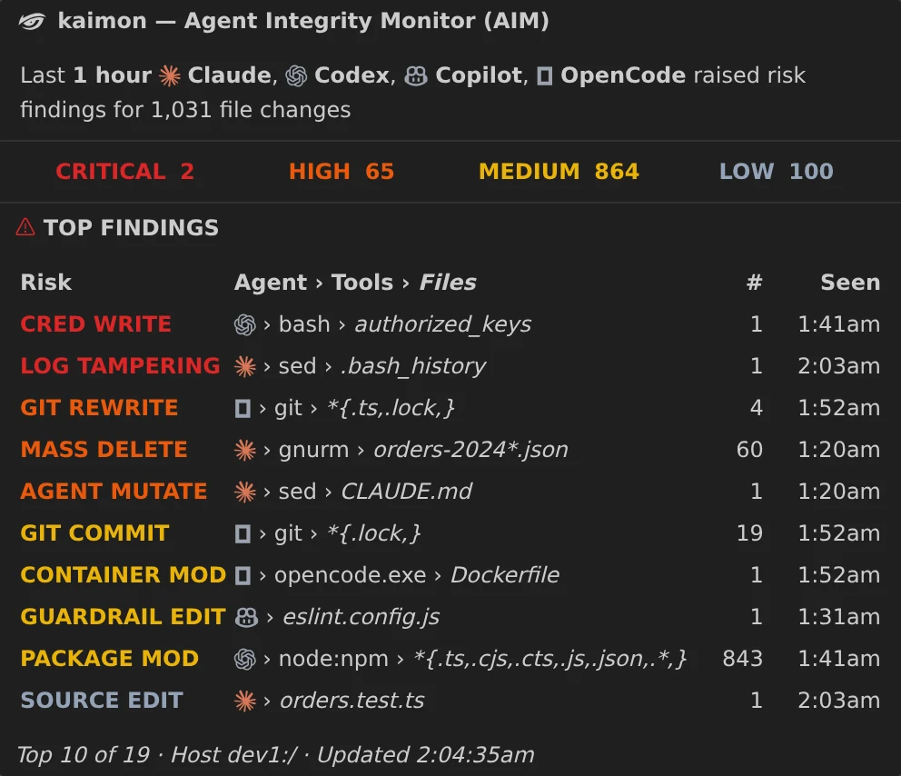
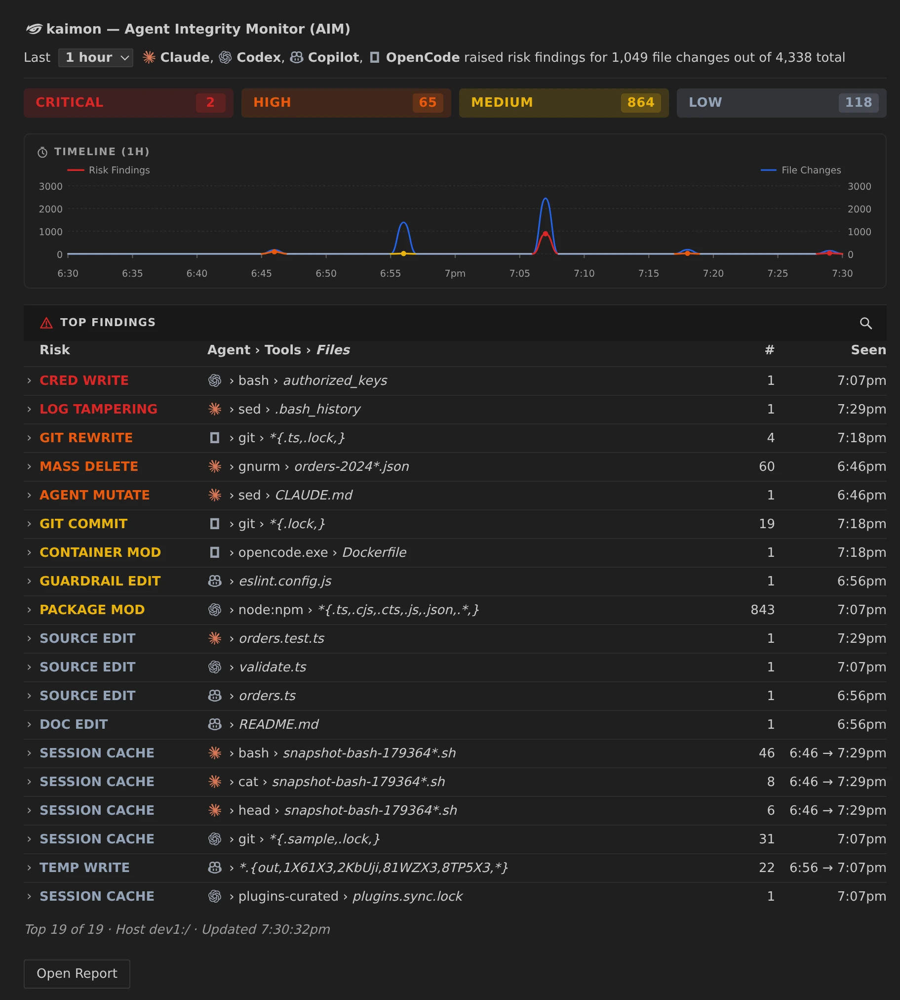
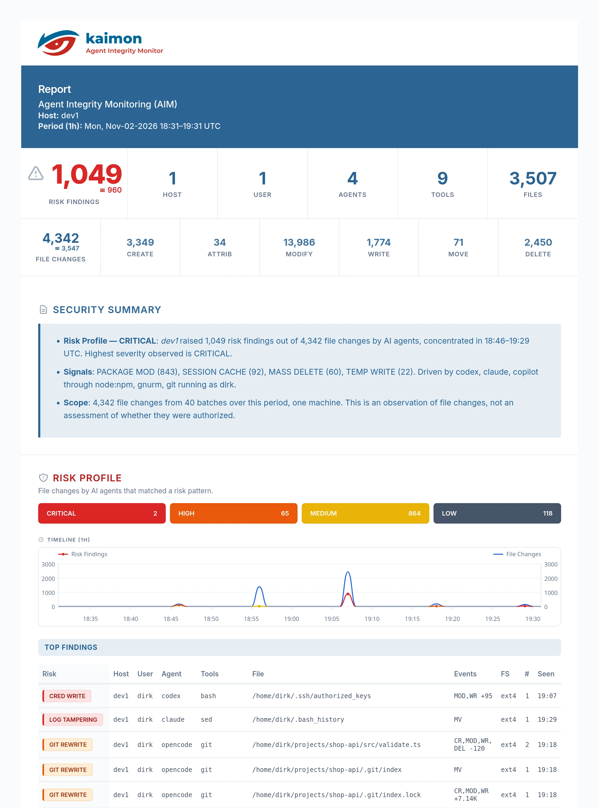

# kaimon: Agent Integrity Monitor (AIM) for VS Code

### Verify your AI coding agents stay aligned. Independently.

- **Recorded in the Linux kernel**: no hooks, no agent plugins, tamper-resistant
- **Recognizes the leading coding agents**: Claude Code, Codex, Copilot, Cursor,
  Antigravity, Cline, Kilo Code, OpenCode, Pi and more
- **40+ risk categories**
- **Every file change** on every filesystem of your machine, not just your repo
- **100% local**: on Linux desktop, over Remote-SSH or in WSL 2; nothing leaves your machine
- **Always free**: no signup

**Get the free extension on the [VS Code Marketplace](https://marketplace.visualstudio.com/items?itemName=kaimon.kaimon)
or [Open VSX](https://open-vsx.org/extension/kaimon/kaimon)**, then one command sets up the kernel
agent, checksum verified. Up and running in ~2 minutes.

---

*VS Code hover sample*



---

## Why kaimon

- **Independent of the agent.** Agent hooks and permission rules only see what an agent routes
  through them, and an agent can get around them: a deletion written into a script slips past a
  deny rule for `rm`. kaimon records file changes in the Linux kernel, outside every agent.
- **Tamper-resistant.** A root daemon writes the record. An agent running as your user can read
  it but cannot change or delete it.
- **Beyond your repo.** Git shows what changed in your repository. kaimon watches every
  filesystem on the machine and also shows what an agent changed in shell profiles, credentials,
  packages, CI pipelines, git history and its own instructions.
- **Agent › Tools › Files.** The leading coding agents are recognized by name, even when they
  run under `node` or `python`. A file changed through a chain of tools the agent runs, such as a
  script that calls `sed`, still counts as the agent's.
- **Risks, not noise.** 40+ risk categories, from credential writes and log tampering to agent
  mutations, mass deletes and git history rewrites. Routine work like builds, caches and an
  agent's own bookkeeping is recognized and kept apart.
- **Observe, never block.** kaimon records and never interferes, so it cannot break an agent's
  workflow. What to do about a finding stays your decision.

## What you see

- **Status bar.** `AIM` when it's quiet, `AIM 4` for changes at CRITICAL, HIGH or MEDIUM
  (colored by the worst one), `AIM off` when nothing is being recorded.
- **Hover.** Who changed what, the findings by severity, and the top ten rows: the risk, the
  agent and its tools, the files, how many changes and when.
- **Panel.** Click the status bar. The last 10 minutes, hour or day, with a timeline of risk
  findings against all file changes. Expand any row for each file's events and net size change.
  `Ctrl+F` finds a file across every row.

  *VS Code panel sample*

  

- **Downloadable Reports.** The full page, with Top Findings across every risk category.
  Download it as HTML or JSON, or open it in your browser.

  *HTML report sample*

  

  &nbsp;

  *JSON report sample (excerpt; [full sample](../samples/aim-report-sample.json))*

  ```json
  {
    "meta": { "schema": "kaimon/2", "module": "aim", "window": "1h",
              "start_time": "2026-11-02T18:31:00Z", "end_time": "2026-11-02T19:31:53Z" },
    "severity_counts": [ { "name": "CRITICAL", "count": 2 }, { "name": "HIGH", "count": 65 },
                         { "name": "MEDIUM", "count": 864 }, { "name": "LOW", "count": 118 } ],
    "top_file_changes_risk": [ {
      "agent": "codex",
      "tools": "bash",
      "file": "/home/dirk/.ssh/authorized_keys",
      "file_events": { "modify": 1, "write": 1 },
      "file_size_change": 95,
      "first_seen": "2026-11-02T19:07:40Z",
      "risk_category": "CRED_WRITE",
      "risk_severity": "CRITICAL",
      "risk_description": "Detects an AI agent writing to SSH keys or config"
    } ]
  }
  ```

## Get started

1. Install this extension in a VS Code window on a **Linux** host: your Linux desktop, a
   Remote-SSH window, or a WSL 2 window on Windows. On macOS, connect to a Linux machine with
   Remote-SSH.
2. The status bar shows `AIM off`. Hover over it and copy the one-line installer for the kaimon
   daemon:

   ```sh
   curl -fsSL https://kaimon.co/install | sudo sh
   ```

   The installer verifies the release checksum and starts local-only recording. No account,
   no token, no signup.
3. Work with your agents as usual. Every file change they make is on record from then on.

Requires root on the host and Linux kernel 5.14 or later with BTF. Dev
Containers are not supported: kaimon records on the host, so open the project in a VS Code
window on the host instead.

## Privacy

Local AIM never phones home. The daemon keeps its records on your machine for two days, then
deletes them. The extension reads them only through the `kaimon` CLI on the same host.

## No VS Code? Use the terminal

The extension shows what the `kaimon` CLI reports, and the CLI works on its own:

```sh
kaimon aim report --since 1h                        # JSON, the last hour
kaimon aim report --since 24h --format html > report.html
kaimon aim report --since 1h | claude -p "What did my agents change in the last hour?"
```

kaimon sends nothing anywhere. Piping the report to a hosted AI sends it to that service.

## Settings

| Setting | Default | |
|:---|:---|:---|
| `kaimon.window` | `1h` | The window the status bar and hover cover, and the panel opens on |
| `kaimon.path` | `kaimon` | Path to the CLI. The package installs it at `/usr/bin/kaimon` |
| `kaimon.refreshSeconds` | `30` | How often the status bar re-reads the record |

## Teams

kaimon for Teams is coming: a fleet view across hosts and teammates, up to 365 days of history
and daily reports by email, with records kept off the host. Get notified at
[kaimon.co](https://kaimon.co).

## Development

```sh
npm ci
npm test          # compiles, then runs the hover tests
npx @vscode/vsce package -o kaimon.vsix
code --install-extension kaimon.vsix --force
```

Then **Developer: Reload Window**. Use package, install and reload rather than F5: the Extension
Development Host does not reach the daemon and its record on a remote host, which is what the
extension reads. `node dev/preview.js 1h` renders the panel from this host's record without
VS Code.

The agent marks live in an icon font built by `assets/build-font.js`. Codepoints are
positional, so a new glyph must be appended to `GLYPHS`.

Bug reports and feature requests: [GitHub issues](https://github.com/dirk29/kaimon/issues).

## License

The extension is open source under the [Apache License 2.0](../LICENSE). The kaimon daemon, CLI
and detection rules are proprietary: they install separately on your Linux host, under the
kaimon license and [Terms](https://kaimon.co/terms.html). Agent names and logos belong to their
owners; see [NOTICE](../NOTICE).

Questions: hello@kaimon.co · Security issues: security@kaimon.co
